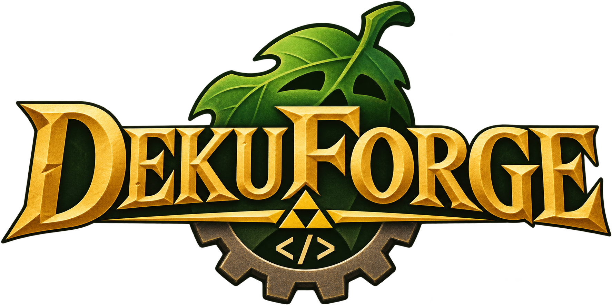

# DekuForge: independent engine development

**Reforging a legend.** This is the `independent` branch. The existing working
Windows build remains on [main](https://github.com/BrutusBossNL/DekuForge/tree/main).

> [!IMPORTANT]
> No ROMs, game assets, keys, generated game source or compiled games are supplied.
> Use your own legally obtained game dump. Do not share game-derived outputs.

## Current status

This branch starts the replacement of the NX2navi-dependent build path with an
original implementation and explicitly approved, redistributable components.
**A source-built experimental Windows game runs locally. The complete NUP build
route is available with explicit developer opt-in; standalone installer support
and parity with main are not established.**

- The default independent backend reports its real capabilities with `--doctor`.
- Original NUP inspection, package selection, verified module preparation and the
  launcher/save-management tooling are retained for development.
- The original A64-to-C translator covers integer arithmetic/flags, branches and
  scalar/register-offset and paired memory operations with a bounded native
  correctness runner, checked against an
  independent ARM64 oracle. It is not a complete CPU backend.
- A guest-memory prototype loads verified NSO segments and bounded MOD0/ELF
  symbol and RELA/RELR pointer relocations; synthetic cross-module calls execute.
  Read-only module analysis reuses extracted inputs without rebuilding them.
- Main's original mod manager, release list/notes and update outcome reporting
  are retained. Asset-mod order and On/Off selections now reach the independent
  runtime through verified snapshots. Independent updates and code-mod builds
  remain disabled.
- Two pinned, separately licensed GPL providers have been evaluated. The first
  was rejected for incorrect shadows. The second verifies 2,188 source blobs
  and runs moving Death Mountain and Kokiri scenes with DekuForge UI adaptations.
  See the [engine plan](docs/INDEPENDENT_ENGINE.md) and
  [scoped measurements](docs/INDEPENDENT_EVIDENCE.md). Full gameplay acceptance
  and standalone installer acceptance remain outstanding. The
  [experimental Windows build guide](docs/OPEN_ENGINE_EVALUATION.md) covers
  pinned generic tools, source compilation and explicit launcher opt-in.
- No automatic fallback to the old experimental 0.3.10 or stable 0.10.1 renderer.
- NX2navi runtime/tool downloads, main-channel app updates and installer packaging
  are disabled. The experimental provisioner downloads verified generic tools;
  the selected GPL engine and AV1 decoder are compiled from source.

The independent Windows bootstrap provisions official generic Python 3.14.10/Tk
and hash-pinned Pillow in this checkout. The locally compiled `DekuForge.exe`
uses that runtime without depending on main's interpreter. Follow the experimental
build guide; an independent end-user installer is not published. A development
Python is also supported for source commands. `run_builder.py --doctor` reports
independent capabilities; `--prepare` prepares modules only and is not a game.

## Known experimental limits

The Windows game builder saves the Vulkan pipeline cache beside the game during
its final validation step. With that cache and a warm NVIDIA driver cache, two
starts on the tested RTX 2080 reached the menu in about 30 seconds and averaged
about 48 fps at native 1080p on Death Mountain Trail. Driver changes and cold
caches can take longer. See [the test evidence](docs/INDEPENDENT_EVIDENCE.md).
The full custom Cheat Manager, independent app updates, end-user setup,
long-session/controller/audio acceptance and Linux/iOS gameplay remain open.

## Reuse and contributions

Reuse only components with an identified open-source license or redistribution
grant, preserving all applicable notices. Changing names or structure does not
remove upstream terms. Original project code remains MIT licensed. The inherited
engine and historical patches remain available for provenance review, not as
blanket-approved inputs to the new backend. This branch also inherits Git history;
it is not presented as a clean-room or fully cleared codebase.

The goal is **at least main's stability, rendering, timing and performance**.
Main remains the reference until the independent implementation passes the same
scenarios. See [INDEPENDENT_ENGINE.md](docs/INDEPENDENT_ENGINE.md) for the component
inventory, acceptance gates and contributor work. Windows comes first; Linux and
iOS testing contributors are welcome after the desktop core is ready.
Earlier failed approaches and reusable measurements are indexed in
[INDEPENDENT_EVIDENCE.md](docs/INDEPENDENT_EVIDENCE.md); main remains untouched.

This is a non-commercial hobby project. We oppose piracy, encourage purchasing
the game/console and do not provide dump/acquisition instructions. We are not
affiliated with Nintendo. Preserve credits for NX2navi and all legitimately reused
upstream components; see [THIRD_PARTY_NOTICES.md](THIRD_PARTY_NOTICES.md).
